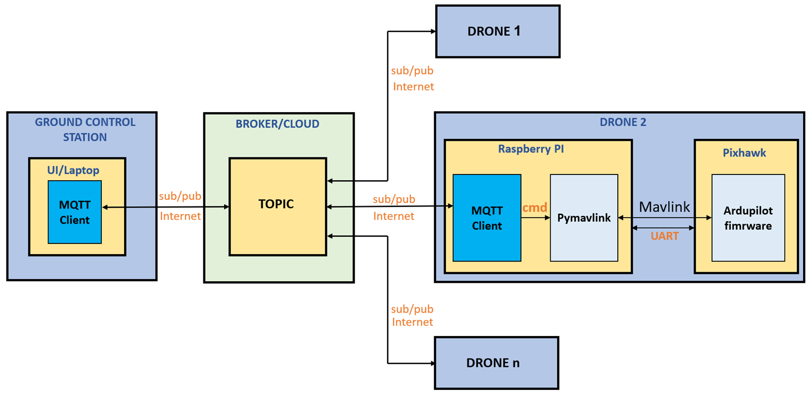
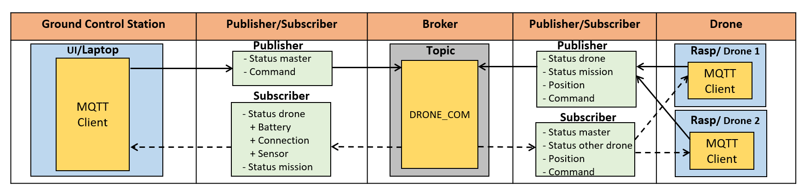

# Swarm Quadcopter Control System

> **Final-year research project** — Distributed control of multiple Pixhawk-based quadcopters (ArduPilot/PX4) from a ground control station using MQTT v5, pymavlink, and PyQt5.

---

## Table of Contents

- [Swarm Quadcopter Control System](#swarm-quadcopter-control-system)
  - [Table of Contents](#table-of-contents)
  - [Overview](#overview)
  - [System Architecture](#system-architecture)
    - [Communication Architecture](#communication-architecture)
    - [MQTT Protocol Architecture](#mqtt-protocol-architecture)
  - [Repository Structure](#repository-structure)
    - [Runtime Roles](#runtime-roles)
  - [Prerequisites](#prerequisites)
  - [Setup](#setup)
    - [1. Clone the Repository](#1-clone-the-repository)
    - [2. Create a Python Virtual Environment](#2-create-a-python-virtual-environment)
    - [3. Configure the MQTT Broker](#3-configure-the-mqtt-broker)
    - [4. Configure the MAVLink Connection](#4-configure-the-mavlink-connection)
    - [5. (Optional) Regenerate the PyQt5 UI](#5-optional-regenerate-the-pyqt5-ui)
  - [Running the Project](#running-the-project)
    - [End-to-End — Master + Multiple Drones over MQTT](#end-to-end--master--multiple-drones-over-mqtt)
    - [PC-Only Simulation (No Hardware Required)](#pc-only-simulation-no-hardware-required)
    - [Standalone Trajectory Flight (Single Drone, No MQTT)](#standalone-trajectory-flight-single-drone-no-mqtt)
    - [Low-Level pymavlink Demos](#low-level-pymavlink-demos)
  - [MQTT Topics \& Message Types](#mqtt-topics--message-types)
    - [Topics](#topics)
    - [Message Types (MQTT v5 User Property `typeMsg`)](#message-types-mqtt-v5-user-property-typemsg)
  - [Troubleshooting](#troubleshooting)
  - [Documentation \& Demos](#documentation--demos)
  - [Contact](#contact)

---

## Overview

This project implements a scalable ground-to-swarm control pipeline for multiple quadcopters. The operator interacts with a **PyQt5 desktop UI** (Master) running on a PC. Commands and telemetry flow over **MQTT v5** through a central broker (Mosquitto or Eclipse public broker). On each drone, a **Raspberry Pi** receives MQTT messages, translates them into MAVLink commands via **pymavlink**, and forwards them to the Pixhawk flight controller over UART.

**Key technologies:**

| Layer | Technology |
|---|---|
| Ground Control UI | PyQt5 (`Sender.py`) |
| Messaging / Transport | MQTT v5 — paho-mqtt, Mosquitto |
| On-board Companion | Raspberry Pi 3/4 |
| Flight Controller Bridge | pymavlink (MAVLink v2) |
| Flight Controller | Pixhawk + ArduPilot / PX4 |
| Trajectory Definition | CSV waypoints (circle, custom shapes) |
| Simulation / SITL | ArduPilot SITL or PX4 SITL |

---

## System Architecture

### Communication Architecture



**Data flow:**

1. The operator issues a command (arm, takeoff, trajectory, land, RTL) in the **PyQt5 Master UI**.
2. The Master publishes the command to the MQTT **broker** on the shared `topicDroneCom22` topic.
3. Each **Drone MQTT Client** (running on the Raspberry Pi) subscribes to the topic and receives the message.
4. The Pi translates the command into MAVLink packets via **pymavlink** and sends them to the Pixhawk over **UART**.
5. The Pixhawk executes the command in **GUIDED** mode and returns telemetry the same path in reverse.

### MQTT Protocol Architecture



**Message flow sequence:**

```
Master                Broker              Drone
  │                     │                  │
  │── MASTER_ONLINE ───►│                  │
  │                     │── MASTER_ONLINE─►│
  │                     │◄─ INITMSG ───────│  (drone announces itself)
  │◄─ INITMSG ──────────│                  │
  │── CMD (arm) ───────►│                  │
  │                     │── CMD (arm) ────►│
  │                     │                  │── MAVLink arm ──► Pixhawk
  │                     │◄─ InfoMsg ───────│  (telemetry)
  │◄─ InfoMsg ──────────│                  │
```

**MQTT v5 configuration used across all clients:**

| Parameter | Value |
|---|---|
| Default broker | `mqtt.eclipseprojects.io:1883` |
| QoS level | 2 (exactly-once delivery) |
| Protocol version | MQTT v5 |
| `clean_start` | `False` (durable sessions — reconnecting drones resume) |
| Message typing | MQTT v5 User Properties (`typeMsg=...`) |

---

## Repository Structure

```
Swarm_quadcopter-/
├── Document/                      # Project report and presentation
│   ├── Report.docx
│   └── Report.pptx
├── env/                           # Pre-built Python 3.11 virtualenv (Linux/Mac layout)
├── pymavlink/                     # Standalone pymavlink demos
│   ├── listen.py                      # Heartbeat sniffer
│   ├── arm.py                         # Arm / disarm
│   ├── takeoff.py                     # Arm + takeoff to 10 m
│   ├── demo_fly.py                    # GUIDED mode + local-NED setpoint
│   └── test_multi_drone.py            # Connect to two MAVLink endpoints
├── Fly_with_Trajectory/           # Single-drone CSV-driven trajectory runner
│   ├── drone1/
│   │   ├── csvCreator.py              # Generate shapes/active.csv
│   │   ├── run_from_csv.py            # Read CSV and execute the mission
│   │   ├── pymavlinkFunction1.py      # MAV class (arm, setMode, takeoff, mission)
│   │   ├── functions/                 # Trajectory generators, CSV builder, plotting
│   │   └── shapes/active.csv          # Current trajectory waypoints
│   └── drone2/                        # Identical layout for the second vehicle
├── MQTT/                          # PC-side Ground Control (Master)
│   ├── README.md                      # Original Mosquitto setup notes
│   └── Tryout_MQTT5/
│       ├── Sender.py                  # Master class + UI launcher  ← entry point
│       ├── CtrlSDPanel.py             # PyQt5 panel (auto-compiles .ui on launch)
│       ├── MQTTProtocol.py            # Thin paho-mqtt v5 wrapper
│       ├── droneMQTT.py               # droneInstance used by simulators
│       ├── Drone1.py / Drone2.py / Drone3.py  # PC-side drone simulators
│       ├── SymbolicName.py            # Topic names, constants, message types
│       ├── pymavlinkFunction.py       # MAVLink helpers
│       ├── csvCreator.py              # Trajectory CSV generator
│       ├── systemControlDrone.ui      # Qt Designer UI source
│       ├── uiSystemDrone.py           # Auto-generated from .ui
│       ├── requirements.txt           # Python dependencies
│       └── TEST_*.py                  # Unit / integration tests
├── Rasp/                          # Raspberry Pi client (mirrors MQTT/)
   └── Tryout_MQTT5/
       ├── Drone1.py / Drone2.py / Drone3.py  # Run one per Pi
       ├── launcher.sh                # Autostart on boot (activate venv → run Drone1.py)
       ├── runDrone.sh                # Minimal manual launcher
       └── ...                        # Same modules as PC side
```

### Runtime Roles

| Component | Host | Entry Point |
|---|---|---|
| Mosquitto broker | Raspberry Pi or any LAN host | `mosquitto -v -c <conf>` |
| Master + Ground Control UI | Windows / Linux PC | `python Sender.py` |
| Drone client | Raspberry Pi (one per Pixhawk) | `python3 Drone1.py` |
| Standalone trajectory | PC + SITL or single drone | `python run_from_csv.py` |

---

## Prerequisites

- **Python 3.11** — the bundled `env/` was built for 3.11.
- **Mosquitto** MQTT broker with v5 support — [download](https://mosquitto.org/download/).
- **ArduPilot** or **PX4** flight controller reachable via MAVLink over UDP (default: `udp:172.30.144.1:14550` — adjust per your setup).
- For hardware-free development: **ArduPilot SITL** or **PX4 SITL**.
- On Raspberry Pi: serial / USB access to the Pixhawk and Wi-Fi reachability to the broker.
- Windows with PowerShell, or Linux / macOS.

**Python dependencies** (`MQTT/Tryout_MQTT5/requirements.txt`):

```
paho-mqtt==1.6.1
pymavlink==2.4.40
PyQt5==5.15.9
PyQt5-Qt5==5.15.2
PyQt5-sip==12.12.2
pyuic5-tool==0.0.1
numpy==1.21.5
pandas==1.3.5
matplotlib==3.5.3
MAVProxy==1.8.67
ujson==5.7.0
DateTime==4.3
future==0.18.2
futures==3.0.5
```

---

## Setup

### 1. Clone the Repository

```powershell
git clone <your-fork-url> Swarm_quadcopter-
cd Swarm_quadcopter-
git checkout Cuong
```

### 2. Create a Python Virtual Environment

> The committed `env/` folder targets a Linux layout — do **not** reuse it on Windows. Create a fresh environment.

**Windows (PowerShell):**

```powershell
python -m venv .venv
.\.venv\Scripts\Activate.ps1
python -m pip install --upgrade pip
pip install -r MQTT\Tryout_MQTT5\requirements.txt
```

**Linux / macOS / Raspberry Pi:**

```bash
python3 -m venv .venv
source .venv/bin/activate
pip install --upgrade pip
pip install -r MQTT/Tryout_MQTT5/requirements.txt
```

### 3. Configure the MQTT Broker

By default all clients connect to the **public Eclipse broker** `mqtt.eclipseprojects.io:1883`. For a private or LAN deployment:

1. Install Mosquitto from [mosquitto.org/download](https://mosquitto.org/download/).
2. Create `mosquitto.conf`:

    ```conf
    listener 1883
    allow_anonymous true
    ```

3. Start the broker:

    ```powershell
    mosquitto -v -c mosquitto.conf
    ```

4. Update the broker address in both `MQTTProtocol.py` files (PC and Pi):

    ```python
    # MQTT/Tryout_MQTT5/MQTTProtocol.py
    # Rasp/Tryout_MQTT5/MQTTProtocol.py
    def __init__(self, client_id, parent=None,
                 broker="<your-broker-ip>", port=1883,
                 username="swarmDrone", password="flyIsOkay"):
    ```

### 4. Configure the MAVLink Connection

Each drone script connects to its Pixhawk via a UDP/serial endpoint. Update the connection string to match your hardware:

| Scenario | Connection String |
|---|---|
| ArduPilot SITL on the same machine | `udp:127.0.0.1:14550` |
| SITL inside WSL2 / Master on Windows | `udp:172.30.144.1:14550` |
| Pixhawk via USB on Raspberry Pi | `/dev/ttyACM0` @ `115200` baud |
| Pixhawk via telemetry serial | `/dev/serial0` @ `57600` baud |

Files to update:

- `Fly_with_Trajectory/drone1/pymavlinkFunction1.py` — `mavutil.mavlink_connection(...)`
- `pymavlink/demo_fly.py`, `arm.py`, `takeoff.py` — same pattern
- `Drone1.py` → `sendFeedbackInfo` call (connection string passed explicitly)

### 5. (Optional) Regenerate the PyQt5 UI

`CtrlSDPanel.py` auto-regenerates `uiSystemDrone.py` from `systemControlDrone.ui` on each launch. To regenerate manually:

```powershell
cd MQTT\Tryout_MQTT5
python -m PyQt5.uic.pyuic systemControlDrone.ui -o uiSystemDrone.py
```

---

## Running the Project

### End-to-End — Master + Multiple Drones over MQTT

**Step 1 — Start the broker:**

```powershell
mosquitto -v -c mosquitto.conf
```

**Step 2 — Launch a drone client on each Raspberry Pi:**

```bash
cd ~/Swarm_quadcopter-/Rasp/Tryout_MQTT5
source ~/.venv/bin/activate
python3 Drone1.py     # Drone2.py / Drone3.py on the other Pis
```

For unattended boot-time startup, use `launcher.sh` (uncomment its contents, then register it):

```bash
crontab -e
# add:  @reboot /home/pi/Swarm_quadcopter-/Rasp/Tryout_MQTT5/launcher.sh
```

**Step 3 — Launch the Master UI on the ground-control PC:**

```powershell
cd MQTT\Tryout_MQTT5
.\..\..\.venv\Scripts\Activate.ps1
python Sender.py
```

The PyQt5 panel opens, connects to the broker, waits for each drone's `INITMSG`, and exposes command buttons (arm, takeoff, run trajectory, land, RTL).

---

### PC-Only Simulation (No Hardware Required)

Run the broker, Master, and three virtual drones in separate terminals:

```powershell
# Terminal A — broker
mosquitto -v -c mosquitto.conf

# Terminal B — Master UI
cd MQTT\Tryout_MQTT5
python Sender.py

# Terminals C / D / E — virtual drones
cd MQTT\Tryout_MQTT5 ; python Drone1.py
cd MQTT\Tryout_MQTT5 ; python Drone2.py
cd MQTT\Tryout_MQTT5 ; python Drone3.py
```

---

### Standalone Trajectory Flight (Single Drone, No MQTT)

**Step 1 — Generate the trajectory:**

Edit the parameters at the bottom of `csvCreator.py`:

```python
shape_name       = "circle"
diameter         = 20
maneuver_time    = 60.0
start_x, start_y = -20, 0
initial_altitude = 10
output_file      = "shapes/active.csv"
```

Then run:

```powershell
cd Fly_with_Trajectory\drone1
python csvCreator.py
# Produces shapes/active.csv and trajectory_plot.png
```

**Step 2 — Execute the mission:**

```powershell
python run_from_csv.py
```

The script waits for `LOCAL_POSITION_NED`, sets GUIDED mode, arms, takes off, then streams waypoints from the CSV.

Repeat for `Fly_with_Trajectory/drone2/` to fly a second vehicle in parallel.

---

### Low-Level pymavlink Demos

Useful for initial vehicle bring-up and debugging:

```powershell
cd pymavlink
python listen.py            # Heartbeat sniffer
python arm.py               # Arm / disarm
python takeoff.py           # Arm + takeoff to 10 m
python demo_fly.py          # GUIDED + arm + takeoff + local-NED setpoint
python test_multi_drone.py  # Connect to two MAVLink endpoints in parallel
```

Edit the `mavutil.mavlink_connection(...)` string in each file to match your endpoint before running.

---

## MQTT Topics & Message Types

Topic names and message type constants are defined in `SymbolicName.py`.

### Topics

| Constant | Value | Purpose |
|---|---|---|
| `DRONE_COM` | `"topicDroneCom22"` | Main bus for Master ↔ drone commands, init, telemetry |
| `CONTROL_COM` | — | Reserved control channel |
| `SYS_COM` | — | System-wide notifications |

### Message Types (MQTT v5 User Property `typeMsg`)

| `typeMsg` Value | Direction | Description |
|---|---|---|
| `MasterLastWillMessageType` | Broker → drones | Master online / offline (Last Will & Testament) |
| `LastWillMessageType` | Broker → Master | Drone joined / dropped (LWT) |
| `InitMessageType` | Drone → Master | Drone self-announcement after `MASTER_ONLINE` |
| `InfoMessageType` | Drone → Master | Periodic telemetry (battery, position, status) |
| `SystemReportMessageType` | Drone → Master | Mission / system report |
| `YawValueMessageType` | Master → drones | Yaw reference for formation flight |
| `CommandType` | Master → drones | Command payload (arm, takeoff, trajectory, land, RTL, …) |

All clients use **QoS 2** and **MQTT v5** with `clean_start=False` so reconnecting drones resume their durable session without losing queued messages.

---

## Troubleshooting

| Symptom | Likely Cause & Fix |
|---|---|
| `ModuleNotFoundError: PyQt5` | Virtual environment not activated — run `Activate.ps1` (Windows) or `source .venv/bin/activate` (Linux), then `pip install -r requirements.txt` |
| `mavutil` blocks on `wait_heartbeat()` | Wrong connection string, flight controller not running, or no UDP forwarder. Verify with `mavproxy.py --master=<connection>` |
| Master UI opens but no drones appear | Broker not reachable or components using different broker addresses. Test with `mosquitto_sub -h <broker> -t topicDroneCom22 -v` |
| `uiSystemDrone.py` regeneration fails | `pyuic5` not on PATH. Run the manual command in [Setup §5](#5-optional-regenerate-the-pyqt5-ui) |
| Raspberry Pi autostart does nothing | `launcher.sh` is committed with its body commented out — uncomment and register via `crontab -e @reboot` |
| Frequent connection drops on public broker | Host your own Mosquitto and update the broker defaults in `MQTTProtocol.__init__` |
| Drone not arming in GUIDED mode | Check that the Pixhawk has GPS lock (or SITL is properly started). Monitor with `listen.py` |

---

## Documentation & Demos

- **Written report**: [`Document/Report.docx`](Document/Report.docx)
- **Presentation slides**: [`Document/Report.pptx`](Document/Report.pptx)
- **Architecture diagrams**: [`Document/Commnication_Architecture.png`](Document/Commnication_Architecture.png), [`Document/Mqtt_protocol_Architecture.png`](Document/Mqtt_protocol_Architecture.png)
- **Mosquitto setup notes**: [`MQTT/README.md`](MQTT/README.md)
---

## Contact

For bugs, questions, or contributions:

- **Email**: vietcuong2002s@gmail.com
- **Zalo**: 0399470672 (Thái Việt Cường)
- **GitHub**: [cuongcodeF4/Swarm_quadcopter-](https://github.com/cuongcodeF4/Swarm_quadcopter-/tree/Cuong)
